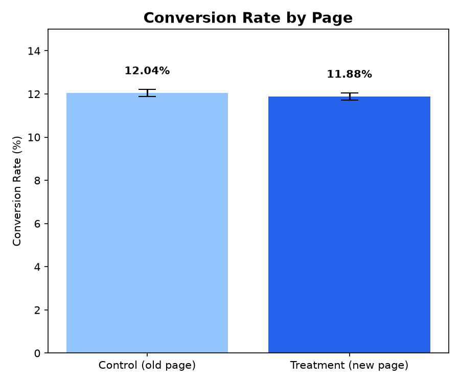
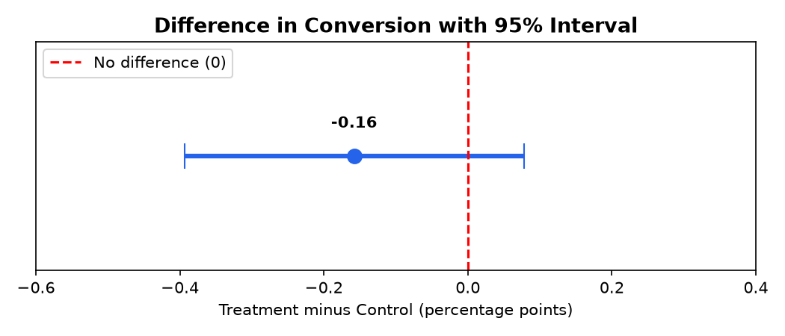

# A/B Test Analysis: Old Page vs New Page (Python + Statistics)

An e-commerce company built a new landing page and wants to know whether it converts more visitors than the old one. This project cleans the experiment data and uses a two-proportion Z-test and a confidence interval to give a data-backed recommendation.

## Business Question
Does the new page produce a higher conversion rate than the old page?

**Hypotheses**
- H0 (null): both pages have the same conversion rate
- H1 (alternative): the conversion rates are different (two-sided test, significance level 0.05)

## Tools Used
- **Python (pandas, numpy, matplotlib)**: cleaning and charts
- **statsmodels**: two-proportion Z-test and confidence interval
- **Jupyter Notebook**: analysis workflow

## Data
294,478 visitors from 2 to 24 January 2017. Each row has the user, the group (control or treatment), the page seen (old or new) and whether the user converted (1 or 0).

## Data Cleaning
| Step | Rows left |
|---|---|
| Raw data | 294,478 |
| Removed users shown the wrong page (3,893): control saw the new page (1,928) or treatment saw the old page (1,965) | 290,585 |
| Removed 1 duplicate user (kept first visit) | **290,584** |

Final groups: control 145,274 users and treatment 145,310 users, nearly equal in size.

## Results
| | Control (old page) | Treatment (new page) |
|---|---|---|
| Users | 145,274 | 145,310 |
| Conversions | 17,489 | 17,264 |
| Conversion rate | **12.04%** | **11.88%** |

- Difference: **-0.16 percentage points** (about -1.3% relative)
- Z-score: **-1.311**, p-value: **0.19**
- 95% confidence interval for the difference: **-0.39 to +0.08 percentage points**

## Conclusion
The p-value (0.19) is above 0.05, so the difference is **not statistically significant**. The confidence interval includes zero, and even in the best case the new page improves conversion by only about 0.08 percentage points. There is **no evidence that the new page is better**.

## Recommendation
1. **Do not roll out the new page** based on this test, since it shows no improvement.
2. Keep the old page, or redesign the new page and run another test.
3. Next time, also track revenue per visitor and run the test for longer than three weeks to capture different traffic patterns.

## Limitations
- Only conversion was measured, not order value or long-term behavior
- The test ran for about three weeks, so seasonal effects are not covered

## Files
- `AB_test_analysis.ipynb`: full analysis (cleaning, test, charts)
- `ab_data.csv`: raw dataset
- `AB_Clean.csv`: cleaned dataset
- `chart1_conversion.png`, `chart2_difference.png`: charts
